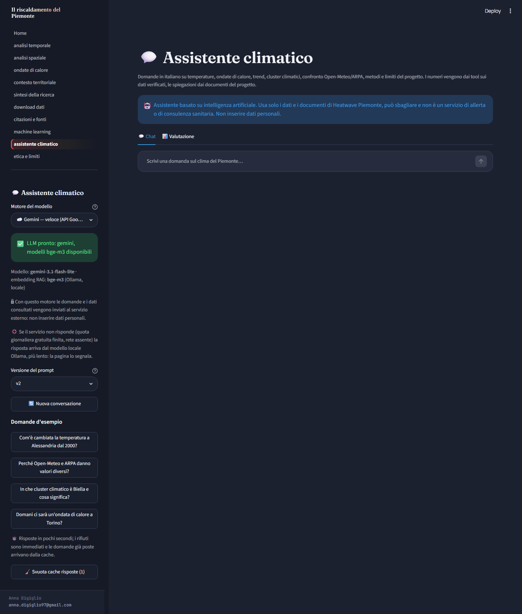
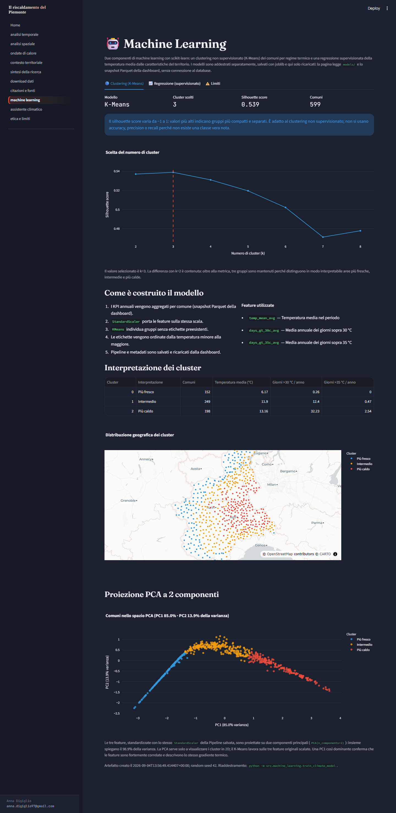
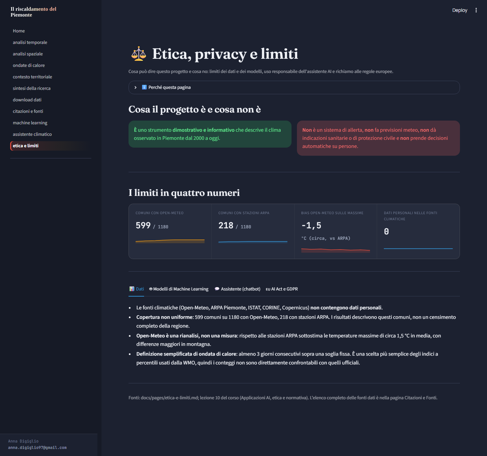

# Il riscaldamento del Piemonte

### Analisi spazio-temporale delle temperature e delle ondate di calore, con un assistente AI che risponde sui dati

[](https://www.python.org/downloads/)
[](docs/pages/testing.md)
[](LICENSE)

Progetto finale del corso ITS *Data Manager for Business Intelligence
Software Developer*. Heatwave Piemonte raccoglie e pulisce 25 anni di
temperature giornaliere dei comuni piemontesi, li confronta con le stazioni
reali di ARPA Piemonte, li analizza con statistica, statistica spaziale e
Machine Learning, e li rende consultabili in una dashboard Streamlit con un
**assistente climatico** basato su LLM, agenti con tool e RAG.



## Le competenze del corso nel progetto

| Competenza richiesta | Dove si trova |
|---|---|
| **Dati con pandas** | ETL di 5,8 milioni di righe (`src/data_acquisition`, `src/data_processing`), pulizia e controlli di qualità, snapshot Parquet |
| **Visualizzazione** | 11 pagine Streamlit con Plotly e Folium, 3 progetti QGIS |
| **Machine Learning (scikit-learn)** | regressione della temperatura (Linear, RandomForest con GridSearchCV, MLP) validata con KFold e GroupKFold; clustering K-Means con silhouette e PCA; modelli salvati con `joblib` |
| **API LLM** | Gemini (piano gratuito) con riserva automatica su Ollama locale; Anthropic opzionale |
| **Agente con tool** | router, analista con 6 tool sui dati in whitelist, ricercatore, revisore dei numeri (`src/chatbot/agent.py`) |
| **RAG** | knowledge base dai documenti del progetto, embedding `bge-m3`, indice vettoriale con similarità del coseno (`src/chatbot/rag.py`) |

## Cosa contiene

- **Dati**: temperature giornaliere Open-Meteo per 599 dei 1180 comuni
  (2000 – luglio 2026), validazione contro 218 stazioni ARPA, popolazione
  ISTAT, uso del suolo CORINE, NDVI Copernicus, confini ISTAT. Database
  PostgreSQL + PostGIS; l'app legge uno snapshot Parquet incluso nel repository.
- **Analisi**: trend (Mann-Kendall e regressione), decomposizione stagionale
  STL, autocorrelazione spaziale (Moran's I), regressione a errore spaziale,
  confronto Open-Meteo contro ARPA (bias di circa −1,5 °C sulle massime).
- **Machine Learning** (pagina 09): il RandomForest spiega la temperatura
  media dei comuni con R² 0,89 in validazione per provincia; l'elevazione è
  il fattore dominante. La rete neurale (MLP) non aiuta su circa 600 righe
  tabellari: è un risultato discusso nella pagina, non nascosto.
- **Assistente climatico** (pagina 10): domande in italiano su trend, ondate
  di calore, confronti tra comuni, cluster, metodi e limiti. I numeri vengono
  solo dai tool sui dati verificati, le spiegazioni dai documenti del progetto
  con le fonti citate. Rifiuta previsioni, consigli medici e tentativi di
  prompt injection senza chiamare il modello.
- **Etica e limiti** (pagina 11): cosa il progetto è e non è, limiti di dati e
  modelli, privacy del chatbot, richiami a AI Act e GDPR.

| Machine Learning | Etica e limiti |
|---|---|
|  |  |

## Avvio rapido (solo l'app)

Non serve PostgreSQL: dati e modelli sono già nel repository. Comandi per
Windows (su Linux/macOS: `source .venv/bin/activate` e `cp` al posto di `copy`).

```bash
git clone https://github.com/annadigiglio-lgtm/Heatwave-.git
cd Heatwave-
python -m venv .venv
.venv\Scripts\activate
pip install -r requirements-dashboard.txt
copy .env.example .env
```

Poi, per l'assistente:

1. **Chiave Gemini gratuita**: crearla su [aistudio.google.com](https://aistudio.google.com)
   ("Get API key") e scriverla in `.env` alla riga `GOOGLE_API_KEY=`.
2. **Ollama** ([ollama.com](https://ollama.com)), che serve per gli embedding
   dei documenti e come riserva locale:
   ```bash
   ollama pull bge-m3
   ollama pull qwen2.5:7b
   ```
3. **Indice dei documenti** (circa 3 minuti su CPU):
   ```bash
   python -m src.chatbot.build_knowledge_base
   ```

Avvio della dashboard:

```bash
streamlit run dashboard/Home.py
```

Senza chiave Gemini l'assistente funziona con Ollama, scegliendolo nella barra
laterale; su un portatile senza GPU una risposta richiede però 1–3 minuti.

## Come funziona l'assistente

```text
domanda → router (regole) ─┬─ fuori ambito / injection / futuro → rifiuto, senza LLM
                           ├─ dati    → tool sui Parquet (scelto dalle regole o dall'LLM)
                           ├─ metodo  → RAG sui documenti del progetto
                           └─ misto   → tool + RAG
        → LLM (Gemini; riserva automatica su Ollama) → revisore dei numeri → risposta con fonti
```

- **Motore**: Gemini 3.1 Flash Lite risponde in 2–12 s. Se non risponde
  (quota giornaliera gratuita finita, rete assente, servizio sovraccarico), la
  domanda passa da sola a Ollama `qwen2.5:7b` e la risposta lo segnala.
- **Cache**: una domanda già posta con gli stessi dati, modello e prompt viene
  servita subito dalla cache locale (`data/cache_risposte/`, fuori da git,
  svuotabile dalla pagina).
- **Valutazione**: benchmark su 28 domande (fattuali, confronti, metodo, dati
  assenti, fuori ambito, injection) con criteri oggettivi. Con il prompt v2:
  **85,7% di risposte corrette, 100% di rifiuti corretti, nessun numero
  inventato**. Il benchmark ha trovato un errore grave ("ci saranno ondate nel
  2030?" riceveva una previsione inventata), poi corretto. I risultati sono
  nella tab *Valutazione* della pagina 10.

## Pipeline completa (facoltativa)

Per rigenerare dati, analisi e modelli serve PostgreSQL 14+ con PostGIS:

```bash
pip install -r requirements.txt
psql -U postgres -f sql/01_init_database.sql          # più sql/03-05 per le covariate
python -m src.data_acquisition.download_data          # altri script in src/data_acquisition/
python -m src.database.load_to_db
python -m src.data_processing.refresh_dashboard       # analisi + export Parquet
python -m src.machine_learning.train_climate_model    # K-Means (richiede il DB)
python -m src.machine_learning.train_temperature_model  # regressore (solo Parquet, ~6 min)
```

## Test e qualità

```bash
python -m pytest tests -q                              # 245 test, senza rete né database
python -m flake8 src/chatbot src/machine_learning tests/chatbot scripts   # moduli d'esame: puliti (.flake8)
python -m tests.chatbot.benchmark --provider ollama    # benchmark del chatbot (modello reale)
```

## Struttura del progetto

```text
├── dashboard/            # Streamlit: Home.py + 10 pagine (09 ML, 10 assistente, 11 etica)
├── src/
│   ├── data_acquisition/ # Open-Meteo, ARPA, ISTAT, CORINE, NDVI, elevazione
│   ├── data_processing/  # pulizia, export Parquet, refresh delle analisi
│   ├── database/         # caricamento in PostgreSQL/PostGIS
│   ├── analysis/         # trend, STL, Moran's I, regressione spaziale, validazione ARPA
│   ├── machine_learning/ # K-Means e regressore della temperatura
│   ├── chatbot/          # client LLM, tool, RAG, agente, memoria, prompt, cache
│   └── utils/            # configurazione, database, logging
├── data/
│   ├── dashboard_export/ # snapshot Parquet letto dall'app
│   ├── knowledge_base/   # schede curate per il RAG
│   └── benchmark/        # risultati della valutazione del chatbot
├── models/               # modelli joblib + metadati
├── tests/                # pytest; tests/chatbot/ contiene anche test set e benchmark
├── docs/                 # documentazione (wiki): index.md, pages/, screenshots/
├── sql/  qgis_projects/  scripts/  paper/
├── config.yaml           # configurazione centrale (chatbot, ML, percorsi)
└── .env.example          # variabili d'ambiente necessarie (senza valori reali)
```

## Documentazione

La documentazione completa è in [`docs/`](docs/index.md):
[architettura](docs/pages/architecture.md),
[dati](docs/pages/data-sources.md), [ETL](docs/pages/etl-pipeline.md),
[analisi](docs/pages/statistical-analysis.md),
[Machine Learning](docs/pages/machine-learning.md),
[chatbot](docs/pages/chatbot.md), [test](docs/pages/testing.md),
[etica e limiti](docs/pages/etica-e-limiti.md),
[glossario](docs/pages/concepts.md).

## Limiti noti

- Copertura: 599 comuni su 1180 con Open-Meteo, 218 con stazioni ARPA.
- Open-Meteo è una rianalisi: sottostima le massime di circa 1,5 °C rispetto
  ad ARPA, di più in montagna e nei giorni più caldi.
- Il progetto descrive il clima osservato: non fa previsioni, non è un
  sistema di allerta e non dà indicazioni sanitarie.
- Il piano gratuito di Gemini ha quote giornaliere basse (anche 20 richieste
  per alcuni modelli); i limiti del proprio account sono su
  [aistudio.google.com/rate-limit](https://aistudio.google.com/rate-limit).
- Con Gemini le domande vengono inviate a Google: non inserire dati personali.
- Sui PC Windows con Smart App Control attivo, ChromaDB e sentence-transformers
  non si possono usare (librerie bloccate): per questo il RAG usa embedding
  Ollama e un indice in numpy.

## Licenza

Distribuito con licenza MIT: vedi [LICENSE](LICENSE).

## Autore

**Anna Digiglio**: laurea in Scienze Naturali, in formazione ITS Data
Manager for Business Intelligence Software Developer.

- GitHub: [@annadigiglio-lgtm](https://github.com/annadigiglio-lgtm)
- LinkedIn: [anna-digiglio](https://www.linkedin.com/in/anna-digiglio-76a144406/)
- Email: anna.digiglio97@gmail.com

## Fonti dati

Open-Meteo, ARPA Piemonte, ISTAT, Copernicus (CORINE Land Cover, NDVI Global
Land Service): dettaglio con link in
[docs/pages/data-sources.md](docs/pages/data-sources.md) e nella pagina
"Citazioni e fonti" della dashboard.
